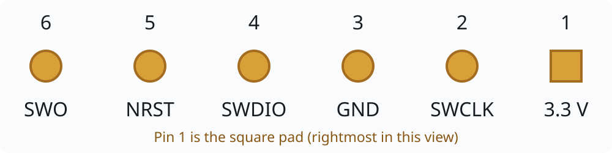

# Iskra JS Embassy blink

STM32F405RG, Rust 2024, Embassy. PB6 alternates between high and low every
500 ms (one full cycle per second). It uses a push-pull output and the external
8 MHz crystal in HSE oscillator mode. PLL M=8, N=336, P=2, Q=7 gives 168 MHz
SYSCLK/AHB, 42 MHz APB1, 84 MHz APB2 and 48 MHz PLLQ. TIM2 runs at 84 MHz and
drives the async timer. Firmware initialization enables SWD debugging during sleep.
RTT logging is nonblocking so blinking continues without a connected debugger.

```sh
rustup target add thumbv7em-none-eabihf
cargo build --release --locked
cargo run --release --locked
```

The runner selects SWD at 1800 kHz and connects under reset through ST-LINK.
This is a conservative flashing default; attaching to the running Embassy
firmware was also verified without `--connect-under-reset`, as described below.
The firmware starts at `0x08000000`; it replaces the stock Espruino firmware.
The chip's factory ROM bootloader remains available.

## SWD connector

The six-pin connector is shown in the same orientation as the supplied pinout:
**pin 1 is the square pad on the right**. Identify that pad on the board before
matching the row; the drawing does not specify which board edge faces up.



| Pin | Signal | Purpose |
| --- | --- | --- |
| 1 | 3.3 V | Target 3.3 V rail |
| 2 | SWCLK | SWD clock |
| 3 | GND | Common ground |
| 4 | SWDIO | Bidirectional SWD data |
| 5 | NRST | Active-low target reset; used for connecting under reset |
| 6 | SWO | Optional trace output |

Match signals by name when connecting ST-LINK; its connector numbering may differ.
SWO is not required for the RTT logging used by this project.

## Original firmware backup

Before flashing, the original 1 MiB flash was read twice and verified identical.
The backup and option-byte snapshot are stored at:

```text
/home/okhsunrog/tmp_zfs/codex_tmp/probe-rs-install/iskra-js-backup/
```

`flash-1.bin` SHA-256:

```text
d588eed19b70fc82c4044f4957c06e1386424f03423222b9f3b6bb77a494151f
```

It matches Amperka's official `espruino_2v01.49_iskrajs.bin` byte-for-byte.

## Hardware validation

Validated on the connected Iskra JS on 2026-10-23:

- Release build, formatting and Clippy with warnings denied passed.
- Programmed through ST-LINK with `--verify`; with HSE/PLL enabled, RTT showed
  alternating levels about 500.012 ms apart for 13 seconds before stopping capture.
- Read RCC CR=`0x03035383`, PLLCFGR=`0x07405408`, CFGR=`0x0000940a`:
  HSE ready in crystal mode, PLL ready, PLL selected as SYSCLK, M=8/N=336/P=2/Q=7,
  AHB /1, APB1 /4, APB2 /2. FLASH ACR=`0x00000005` confirms five wait states.
  Frequencies follow from the board's stated 8 MHz crystal; no external frequency
  measurement was performed.
- GPIOB MODER was `0x00001280` and OTYPER was `0`, confirming PB6 as push-pull output.
- Sampled GPIOB IDR/ODR in both states: `0x350`/`0x40` for high and
  `0x310`/`0x00` for low. Both the output latch and input readback changed on PB6.
- Closed the debug session and reset the board to leave the firmware running.

Visual LED operation was not independently observed. The register samples confirm
both logic levels at PB6.

## Connecting without reset

With this Embassy firmware already running, all of the following checks passed
without `--connect-under-reset`, power cycling, resetting, or flashing:

- CPUID read returned `0x410fc241`.
- Six consecutive GPIOB reads succeeded and captured both PB6 levels.
- RTT attach received continuing `PB6 high` / `PB6 low` messages with increasing
  uptime, without restarting the application.
- `info --verbose` enumerated the debug port and CoreSight components.
- DBGMCU_CR at `0xe0042004` read `0x7`: debugging in Sleep, Stop and Standby enabled.

Run these commands from the project directory:

```sh
probe-rs read b32 0xE000ED00 1 --chip STM32F405RGTx --protocol swd --speed 1800
probe-rs read b32 0x40020410 2 --chip STM32F405RGTx --protocol swd --speed 1800
probe-rs info --protocol swd --speed 1800 --verbose
probe-rs attach target/thumbv7em-none-eabihf/release/iskra-js-embassy \
  --chip STM32F405RGTx --protocol swd --speed 1800 \
  --no-catch-reset --no-catch-hardfault
```

Plain `probe-rs info` still fails with "The connected chip could not automatically
be determined." This is a separate chip-autodetection limitation: basic `info`
tries to identify an exact chip, whereas `info --verbose` enumerates components.
Basic `info` ignores `--chip`; use the explicit chip selection for memory and RTT
commands, and `--verbose` for component inspection.

The original Espruino firmware was observed entering Sleep through `WFI`, and
attaching to it without reset was unreliable. That behavior was not reproduced
in the final Embassy no-reset checks. `probe-rs` restores the previous DBGMCU_CR
value on detach, so these results describe the tested state and are not a
guarantee for every firmware or debug-session sequence.
